<p align="center"></p>

# Party Queue

<p align="center">
<a href="https://party-queue.github.io/en/"><b>Website</b></a> ·
<a href="https://party-queue.github.io/pl/"><b>Strona (po polsku)</b></a> ·
<a href="README.pl.md">README po polsku</a> ·
<a href="https://github.com/party-queue/party-queue/releases/latest">Releases</a>
</p>

**One phone. One queue. Everyone's songs.** Party Queue turns an Android phone into a party jukebox: it plays YouTube **without ads**,
guests add songs from **their own phones or laptops** through a web page, and the host decides what plays next.
No accounts, no API keys, nothing to install for guests.

<table>
<tr>
<td align="center" width="220">
<a href="https://github.com/party-queue/party-queue/releases/latest/download/party-queue.apk"></a><br>
<b>Scan to download</b><br><sub>the newest APK, Android 10+, arm64, ~225 MB</sub>
</td>
<td>

**Install:** open the link below on your phone (or scan the code), open the downloaded file, allow *Install unknown apps* when asked, and
choose *Install anyway* if Play Protect complains. **Update:** download the new APK the same way and install it over the old one.

**[⬇ party-queue.apk](https://github.com/party-queue/party-queue/releases/latest/download/party-queue.apk)** ·
[checksum](https://github.com/party-queue/party-queue/releases/latest/download/party-queue.apk.sha256) ·
[all releases](https://github.com/party-queue/party-queue/releases) · [release feed](https://github.com/party-queue/party-queue/releases.atom)

Step by step with pictures: **[party-queue.github.io](https://party-queue.github.io/en/#install)**
</td>
</tr>
</table>

<p align="center">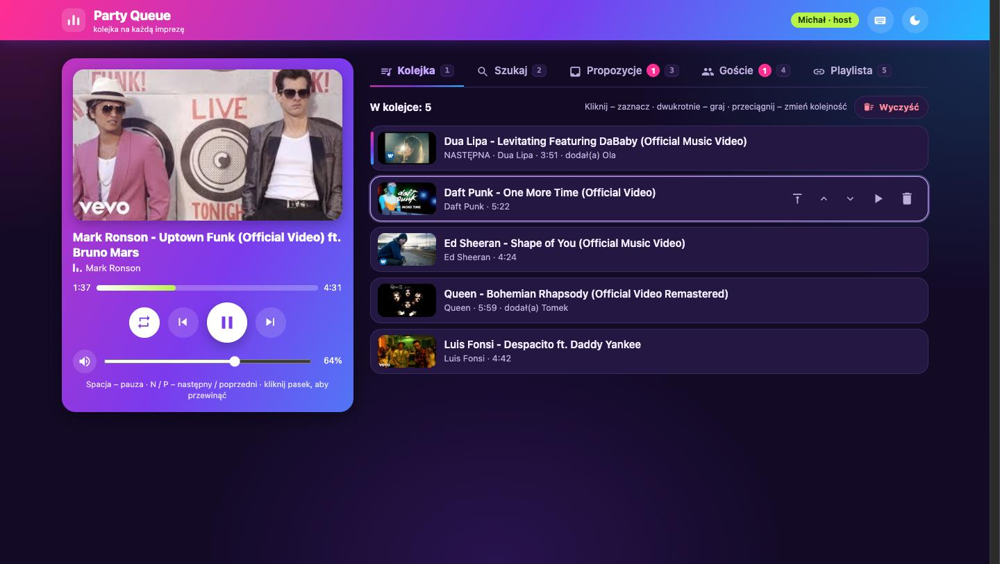</p>

## What it does

- plays YouTube **without ads** in an embedded Firefox engine (GeckoView) with uBlock Origin built in, and keeps playing with the screen off,
- changes songs instantly (the next one is preloaded in a hidden second player) and fades between songs when you skip,
- loads a **public playlist** into a local queue in YouTube's order (no Google login, no API key), or songs you search for in the app,
- a **YouTube tab** with an address bar to browse YouTube and set a playlist as the current one (or add a video as next / at the end) with the round **+** button,
- gestures on the queue: tap to move a song to the top, swipe right to play now, left to remove, hold and drag to reorder,
- serves a **guest web page** on the local network; guests open it (the QR code in the *Zaproś* tab just opens it), propose songs, the host approves them as next or at the end,
- the host can make any guest a **co-host**, who can run the party from a laptop (keyboard shortcuts, drag and drop, volume, everything the host can do),
- light and dark themes, landscape layout, and a careful use of the battery.

The full list with pictures is on the **[website](https://party-queue.github.io/en/#features)**. The queue is local to the app. Nothing is written back to YouTube.

Requires Android 10 or newer (API 29), arm64. Licence: [AGPL-3.0](LICENSE); bundled components are listed in
[THIRD_PARTY.md](THIRD_PARTY.md). Using it may conflict with YouTube's Terms of Service.

## Screenshots

The host's app:

<p>
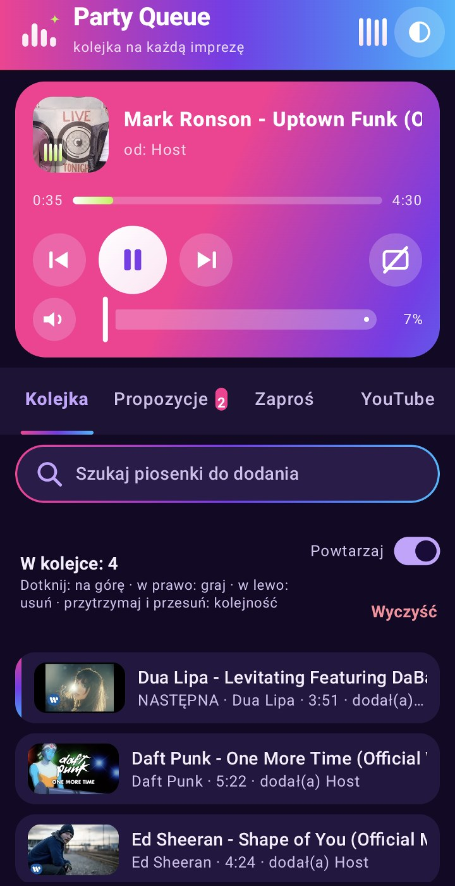 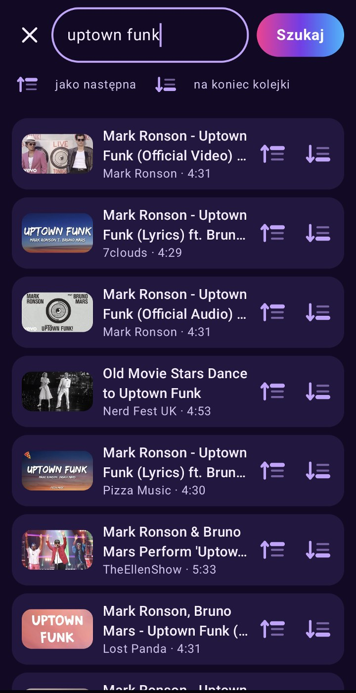 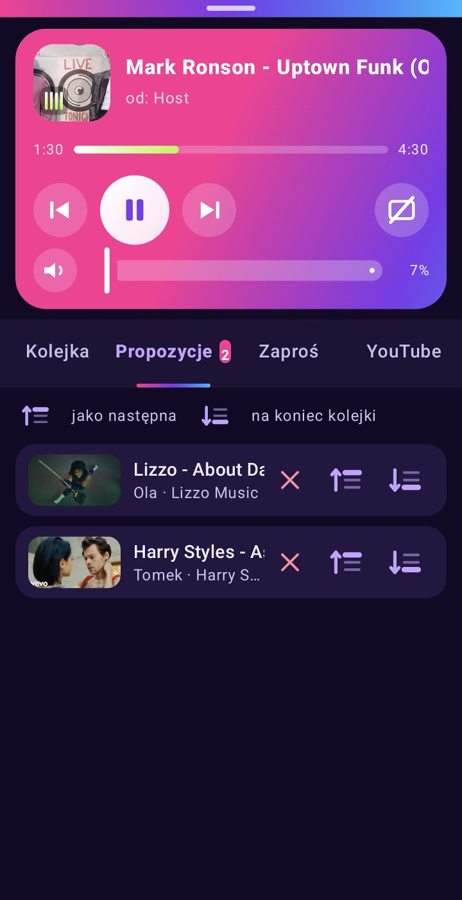 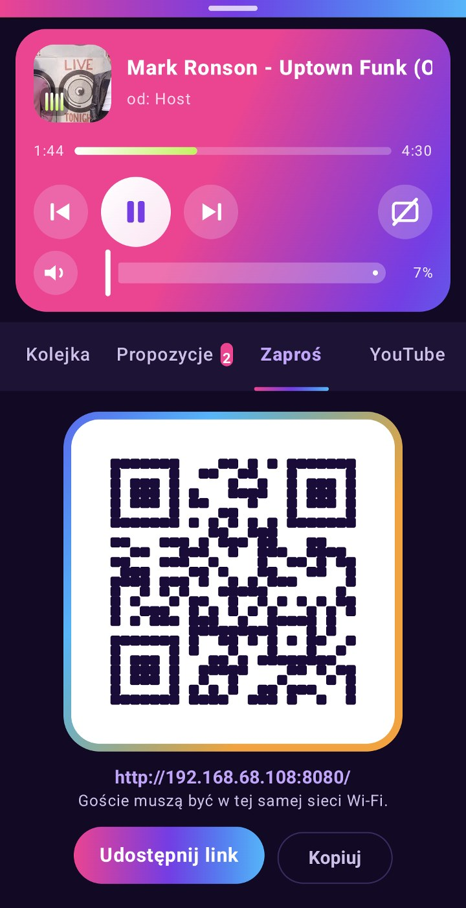
</p>
<p>
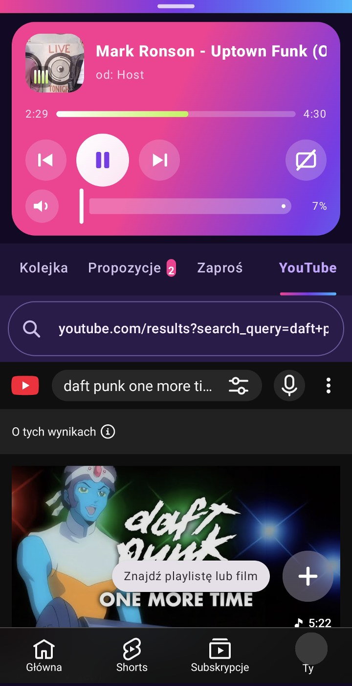 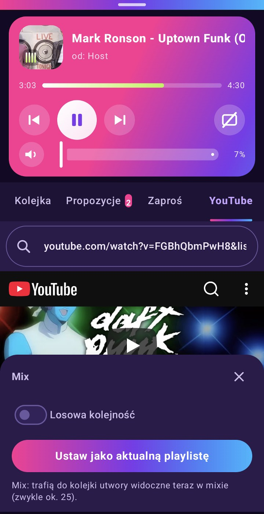 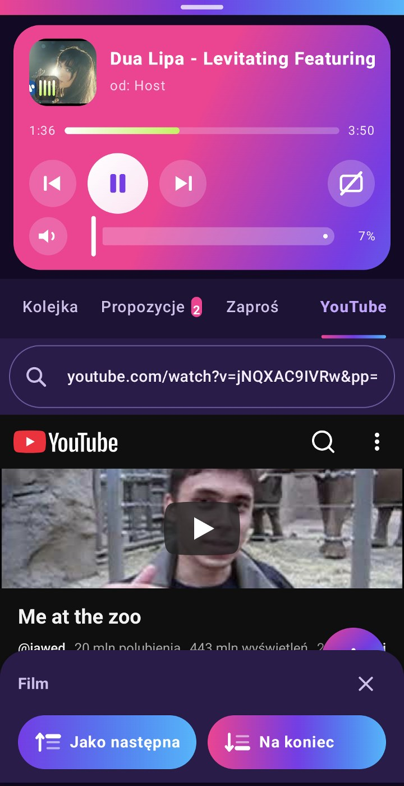 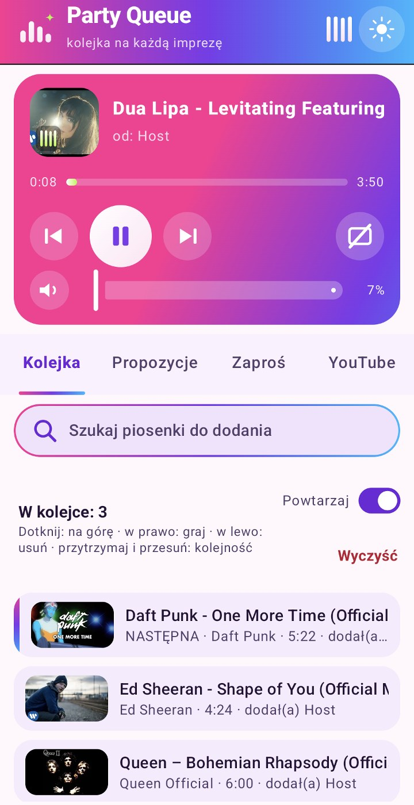
</p>

The page guests and co-hosts see:

| | |
| --- | --- |
| 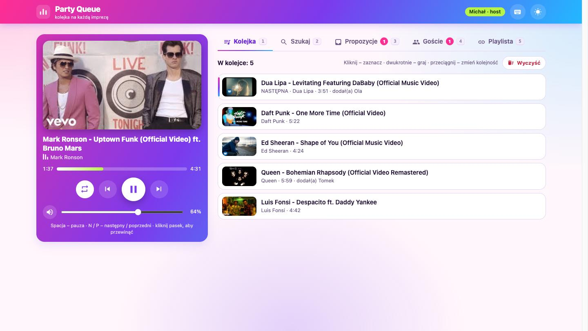 | 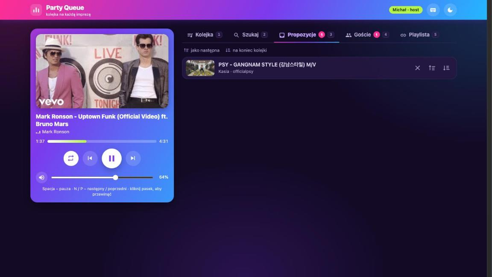 |
| 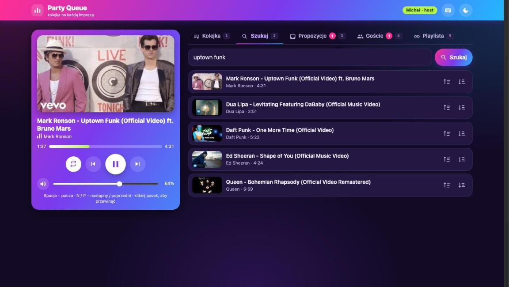 | 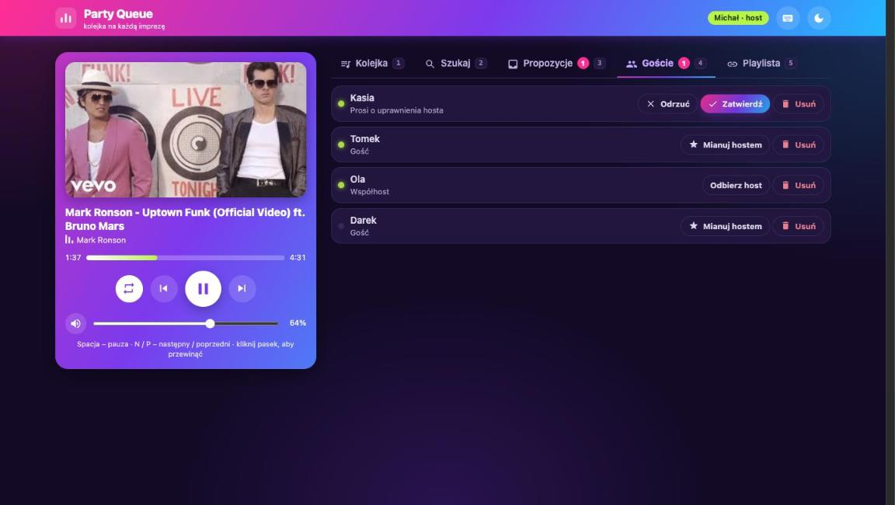 |
| 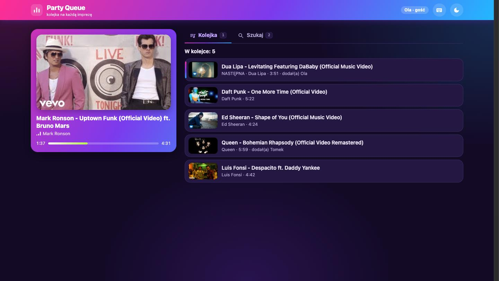 | 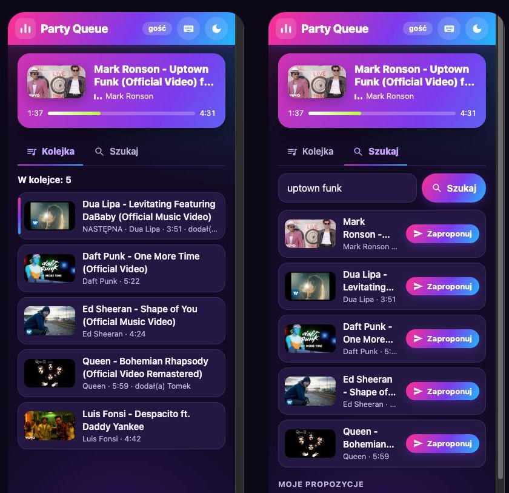 |

## Build and install

```bash
export JAVA_HOME=/opt/homebrew/opt/openjdk@17/libexec/openjdk.jdk/Contents/Home
export ANDROID_HOME=/opt/homebrew/share/android-commandlinetools
./gradlew assembleDebug
$ANDROID_HOME/platform-tools/adb install -r app/build/outputs/apk/debug/app-debug.apk
```

The first build downloads uBlock Origin and the background-playback add-on (checksum-verified, see
`addons.lock`). GeckoView 157 needs compileSdk 37.1 and AGP 9.x (see `build.gradle.kts`).

## Test

```bash
./gradlew lintDebug testDebugUnitTest      # automatic checks, also run in CI
scripts/smoke-test.sh <phone-ip> [serial]  # end-to-end against a phone running a debug build
```

The full quality process (including the manual checklist for releases) is in [docs/QA.md](docs/QA.md);
how to contribute and cut a release is in [CONTRIBUTING.md](CONTRIBUTING.md). The version is in `version.properties`,
the history in [CHANGELOG.md](CHANGELOG.md).

## How it fits together

| Piece | File |
| --- | --- |
| Queue, proposals, guests, roles, playback logic | `PartyController.kt` |
| Key-less YouTube search / playlist / metadata (reads the public pages) | `YouTubeClient.kt` |
| HTTP + WebSocket server (Ktor CIO, port 8080) | `PartyServer.kt` |
| GeckoView session and add-on messaging | `PlayerBridge.kt`, `assets/extensions/bridge/` |
| Host UI (Compose, respects system bars) | `HostScreen.kt` |
| Guest web page | `assets/guest/index.html` |
| Keeps the process alive (wake lock, Wi-Fi lock, notification) | `PlaybackService.kt` |
| Pure parsing of YouTube's embedded JSON | `YouTubeParser.kt` |

Add-ons are bundled unpacked in `assets/extensions/`. The bridge add-on's version in `manifest.json`
must be bumped whenever its scripts change, otherwise GeckoView keeps the old copy.

## Things worth knowing

- `PartyApp.onCreate` also runs inside every Gecko child process; only the main process may create the runtime.
- Two hidden player pages take turns: while one plays, the other already holds the next song (paused, muted), so a change of
  song is instant. YouTube makes people who block ads wait 5-13 s for a video to start; this hides that wait.
- Autoplay is allowed through the session `PermissionDelegate` (Gecko prefs alone were not enough).
- The mobile YouTube site loads nothing until its play button is pressed; the bridge presses it.
- The bridge rejects the YouTube cookie banner ("reject all") automatically.
- The HTTP server has no TLS: use it on a network you trust. Anyone who opens the page and gives a name is
  a guest (they get a random token); the host can close joining and still approves every proposal.
- Some routers isolate Wi-Fi clients; use the host phone's hotspot in that case.

## Your own playlists

Public and unlisted playlists: paste the link in the address bar of the *YouTube* tab (or open the playlist there), then press the round **+** and *Ustaw jako aktualną playlistę*.
Playlists keep the order they have on YouTube (shuffling is an explicit switch).
Private playlists: sign in via *Zaloguj się* in the YouTube tab and import from there (experimental). The simplest
workaround is to set the playlist to *Unlisted* on YouTube. The first ~100 videos of a playlist are imported.

## Not done yet

- No lock-screen media controls (MediaSession).
- No write-back to YouTube / private playlists (would need Google sign-in and the Data API).
